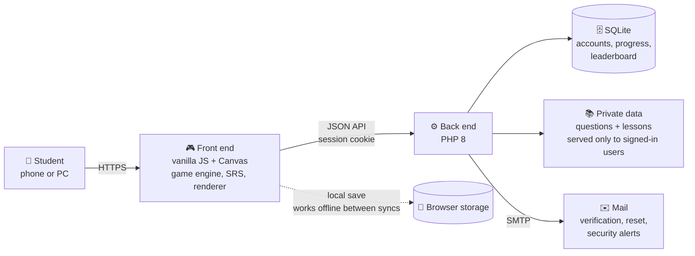
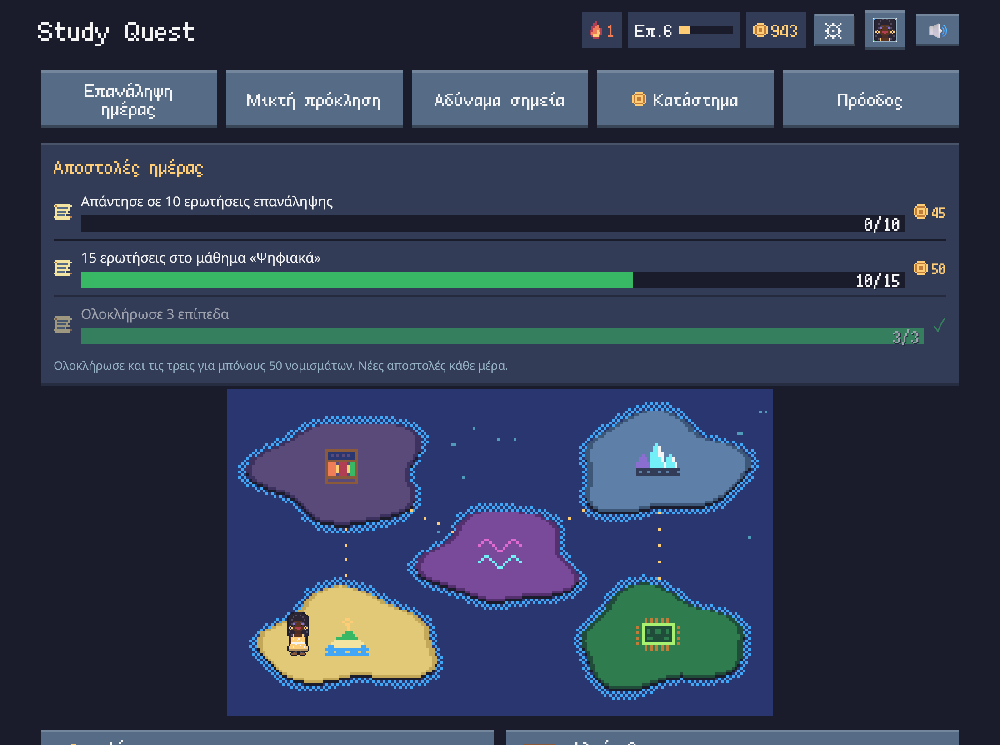
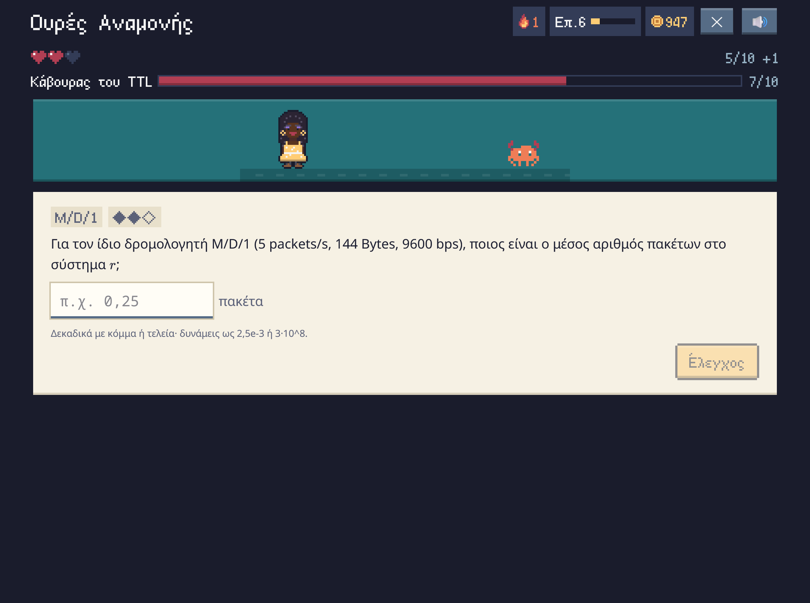
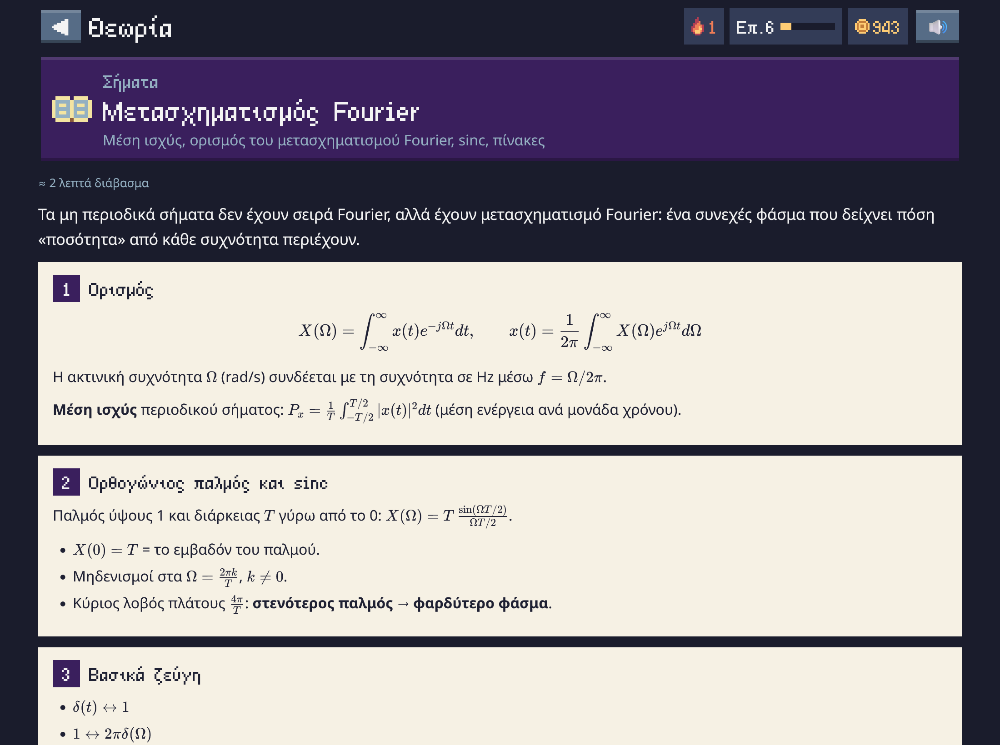
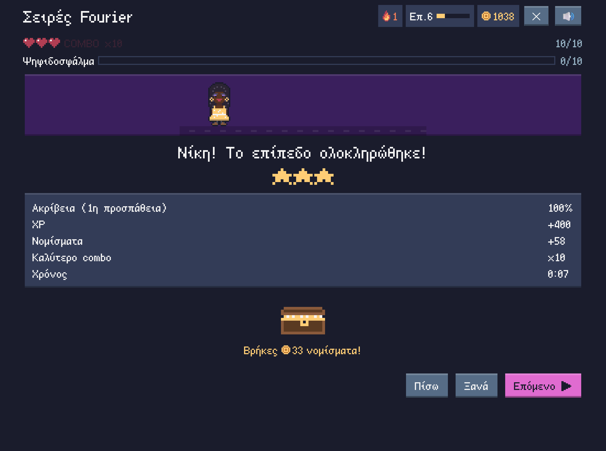
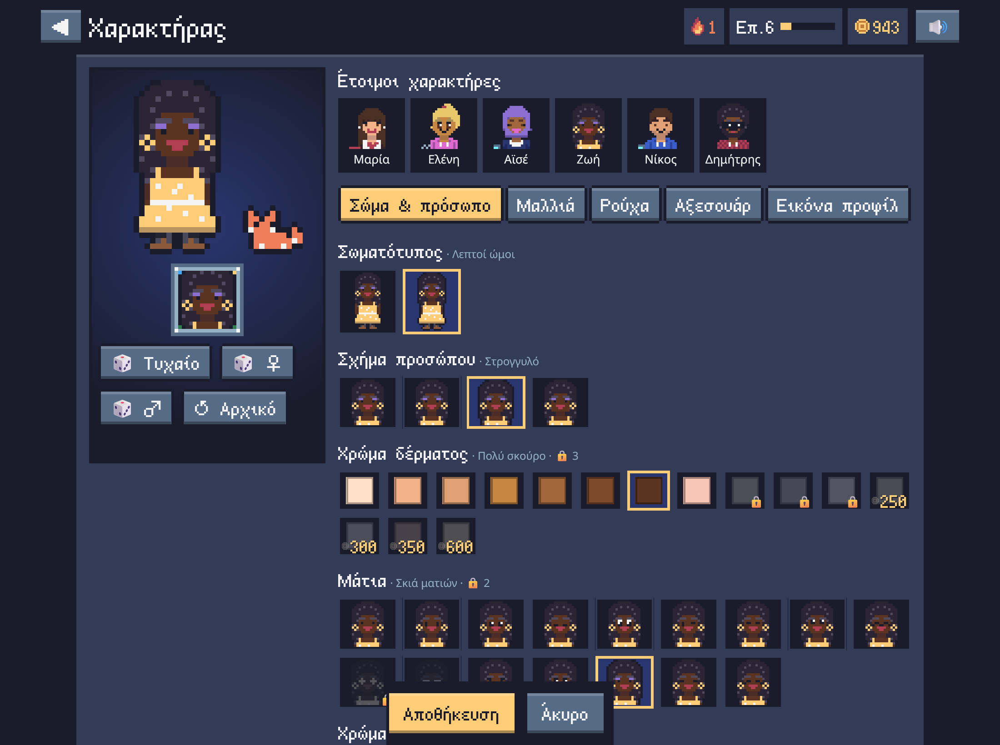
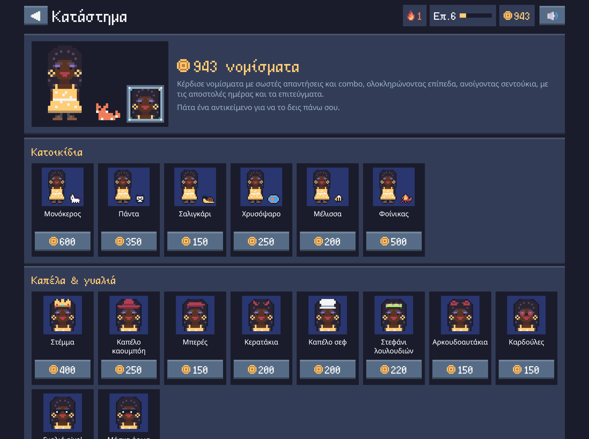
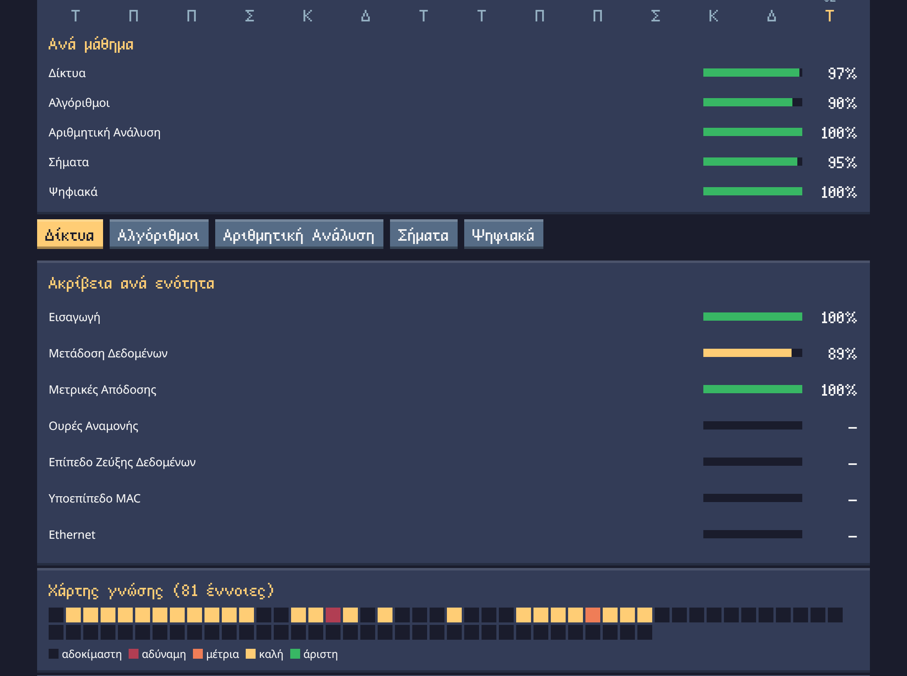
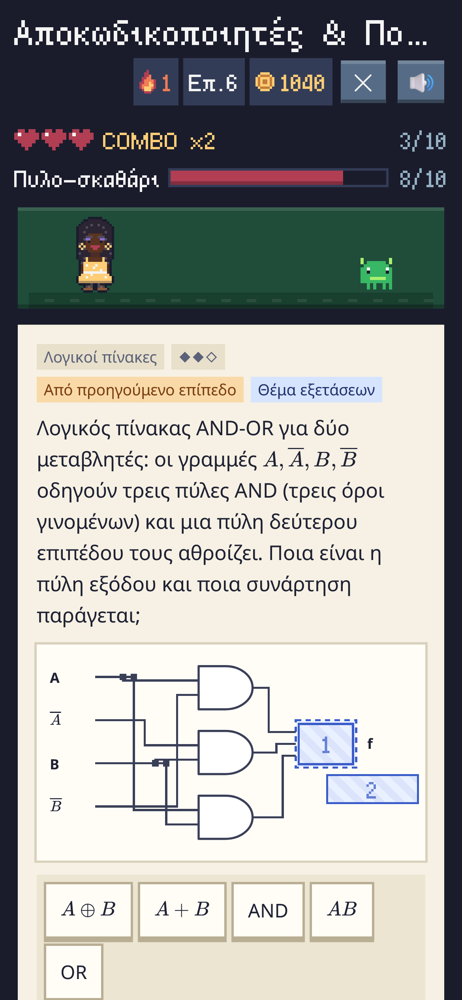

# 🎮 Study Quest: Η Αναζήτηση της Γνώσης

**A website for my university that makes studying feel like a game.**
Pixel-art battles, daily quests and spaced repetition turn five hard computer-engineering courses into an adventure you actually want to come back to.

🔗 **Live site:** [intzirtzis.xyz](https://intzirtzis.xyz) (free account, in Greek)

---

## The problem

Courses like Computer Networks, Signals & Systems or Numerical Analysis come with hundreds of pages of slides. Most students (me included) read them once before the exam, forget them a week later, and never get feedback on what they actually understand. Flashcard apps exist, but they don't know the course material, they can't ask "compute the channel capacity" or "put the OSI layers in order", and they are boring.

## My solution

**Study Quest** turns each course into a region of a pixel-art world. Every chapter is a level with an optional theory lesson and a battle against a monster, where every correct answer is a hit. The game tracks every concept you've seen and schedules reviews right before you'd forget it. All questions and lessons are written from the real course material, with the source slide and page for each one.

---

## Game mechanics

| Mechanic | What it does | Why it helps learning |
|---|---|---|
| ⚔️ **Battles** | Each level is a fight: the enemy has one HP per question, a wrong answer costs a heart | Turns a quiz into a challenge with stakes, so you focus on every question |
| 🔁 **Retry the concept** | A missed question comes back 2–4 questions later as a *different* variant | Tests understanding of the idea, not memory of one question |
| 🧠 **Spaced repetition** | Every miss enters a review queue (next session → 1 → 3 → 7 → 14 days) | Reviews arrive right before you would forget, the most efficient way to remember |
| 📖 **Theory lessons** | Short lesson per level, also one tap away after a wrong answer | Learn → practise → get feedback, in one place |
| 🔥 **Combos & crits** | Correct answers in a row multiply XP and coins | Rewards consistency and flow |
| ☠️ **Boss fights** | Unlock after all levels of a region; draw from the whole course | Mixed practice across chapters, like the real exam |
| ⏱️ **Exam mode** | 20 timed questions, no hints until the end | Simulates exam pressure |
| 🪙 **Coins & shop** | Earn coins, buy cosmetic items for your character | Extrinsic motivation without pay-to-win |
| 📜 **Daily quests** | Three small goals per day, plus a bonus for all three | Builds a daily study habit |
| 🏅 **Badges & streaks** | 29 achievements, daily study streak | Long-term goals and visible progress |
| 🏆 **Leaderboard** | XP, streak and mastered concepts, opt-in | Friendly competition between classmates |
| 🎨 **Character creator** | Full pixel-art avatar editor (body type, face, hair, clothes, pets…) | Ownership and identity keep players coming back |

---

## Features

- **5 courses, 43 levels, 576 questions, 43 theory lessons**, all in Greek, each question citing its source slide/page
- **7 interactive question types**: multiple choice, true/false, fill-in (typed or drag chips), ordering, matching, numeric (with tolerance and units), and labelling diagrams
- **Math everywhere** rendered with KaTeX; code questions in C, VHDL and MATLAB with syntax highlighting
- **Accounts that follow you**: progress, character and coins sync between phone and PC
- **Email verification, password reset and security alerts** (custom SMTP client)
- **Installable app** (home-screen icon, full screen), works on phones and desktops
- **Accessible**: keyboard play, reduced-motion support, large touch targets
- **Everything generated in code**: all pixel art, animations and chiptune sounds, no image or audio files
- **Security-first backend**: the password never leaves the browser (PBKDF2 + bcrypt), HttpOnly/SameSite sessions, CSRF protection, rate limits, HSTS and security headers, daily database backups

---

## How it works

1. The student signs in; the browser derives a key from the password (it never sends the password itself).
2. The front end loads the course data through the API and runs the whole game locally: battles, spaced repetition and mastery tracking.
3. Progress is saved in the browser and synced to the server, so it follows the player between devices.
4. The server keeps accounts and progress in SQLite, takes a daily backup, and sends the account emails.

---

## Screenshots

| | |
|---|---|
|  |  |
| *World map with daily quests* | *A battle: enemy HP, hearts, combo* |
|  |  |
| *Theory lesson with math* | *Victory, stars and a loot chest* |
|  |  |
| *Character creator* | *Coin shop* |
|  |  |
| *Knowledge map and stats* | *On a phone* |

---

## Impact

- 🌍 Live and public at [intzirtzis.xyz](https://intzirtzis.xyz), with HTTPS, account emails, daily backups and GDPR-ready [privacy](https://intzirtzis.xyz/#/legal/privacy), [terms](https://intzirtzis.xyz/#/legal/terms) and [cookies](https://intzirtzis.xyz/#/legal/cookies) pages
- 📚 576 questions and 43 lessons covering 5 semester courses
- 📱 Used on both phones and desktops

---

## Challenges & what I learned

- **Turning lecture slides into good questions.** Writing 576 questions that test understanding (not trivia), with variants of the same concept and a source for every answer, taught me a lot about the material itself. I also built validators that recompute every numeric answer and check Greek typography.
- **Learning science in practice.** Implementing spaced repetition, concept mastery and "retry the same idea in a different form" showed me how much *when* you review matters.
- **Game feel.** Small things (a hit animation, a combo sound, a chest you tap to open) change how motivating the same quiz feels.
- **Security from scratch.** Designing login without ever sending the password, sessions, CSRF protection, rate limiting and safe email flows, then auditing and hardening the live site.
- **Shipping and running a real website.** Domain, DNS, HTTPS, deployments, backups and email deliverability (SPF, DKIM, DMARC), and why a brand-new domain lands in spam at first.
- **Mobile-first pixel UI.** Keeping pixel art crisp at every screen density and making a dense game screen usable on a 320-px phone.

---

## Source code

The source code is kept in a private repository, because the questions are based on copyrighted course material.
**Source code available on request.**

## Contact

**Giannis Intzirtzis**: [LinkedIn](https://www.linkedin.com/in/giannis-intzirtzis/)
